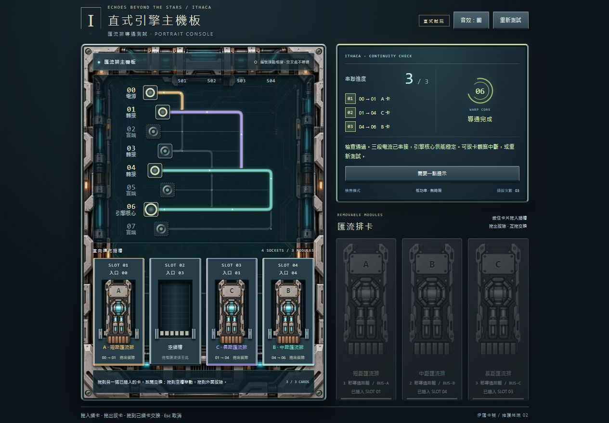
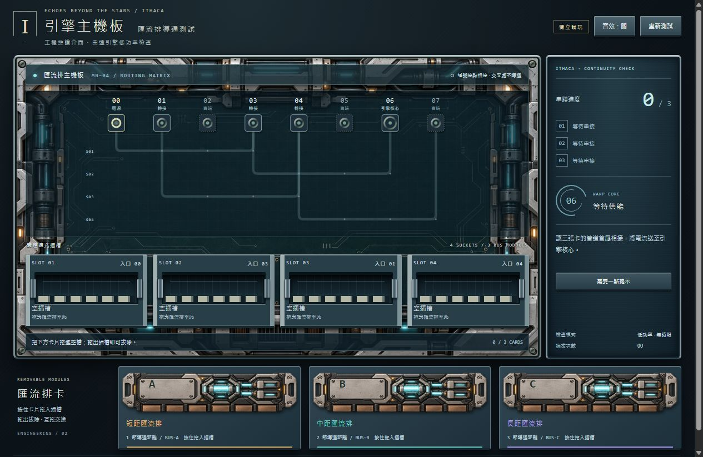

# 匯流排可攜式開發包驗證紀錄

日期：2026-10-16（Asia/Taipei）。環境：Windows x64，Node.js v24.19.0，Codex 內建瀏覽器。

UI 檢查適用 [browser-ui-focus-visuals 技能](../rules/browser-ui-focus-visuals/SKILL.md)。本次不改遊戲 UI／輸入實作；驗證可搬移的包裝與既有行為。

## 已完成

- 兩個原始預覽資料夾共 **38 個檔案**逐一比對 SHA-256，與 Worktree 來源一致。保留兩版所有原始碼、既有測試、美術與提示詞。
- 實際執行根目錄 `test.cmd --no-pause`：橫式 14／14、直式 14／14，合計 **28／28 通過**。
- 根目錄伺服器、測試入口與完整性檢查腳本通過 Node 語法檢查。
- 將整份開發包複製到含中文與空白的獨立目錄 `bus-card-restore-validation/家裡還原 空白路徑/`，從其他工作目錄呼叫實際 `start.cmd --port 0 --no-open` 成功。
- 伺服器自動配置空閒埠；兩版均由同一個 loopback 伺服器提供。沒有使用原 Worktree 的伺服器來冒充搬移驗收。
- 瀏覽器開啟搬移版 `/portrait/`：主板與直向卡片正常、標號文字對齊、終端槽位錯開、盲端細線顯示。
- 透過實際介面點選 A → S01、C → S03、B → S04，等待動畫後顯示 **3／3、導通完成**。
- 在搬移版使用實際指標拖曳交換 S03 的 C 與 S04 的 B：結果 S03=B、S04=C，插拔計數由 03 成為 07，完成狀態中斷，沒有卡片遺失。
- 瀏覽器開啟搬移版 `/landscape/`：橫式主板、卡片與介面正常顯示。
- 上述兩版瀏覽器檢查沒有收到 console error。

圖片證據：





## 可在家中重跑

```powershell
node scripts/verify.mjs
node scripts/test.mjs
node server.mjs --port 0 --open
```

封裝基準 `manifest.json` 記錄每個檔案的大小與 SHA-256，並列出 PNG 尺寸。它不雜湊自身。外層 ZIP 的 SHA-256 存在 ZIP 旁的 `.sha256.txt`。封裝完成後另有完整解壓與逐檔雜湊檢查，以確認 ZIP 可還原。

## 未驗證範圍

- 家中實際電腦、其他 Node 版本、macOS／Linux。
- 本次未用實體手把或手機重測；現有輸入測試含模擬事件，不能等同硬體驗收。
- 本次啟動時使用 `--no-open`，系統預設瀏覽器自動喚起路徑未實測；若沒有自動開啟，手動貼上命令視窗印出的網址即可。
- 本次未重新做所有手機尺寸、音效播放或主遊戲整合測試；主遊戲整合本來就不在本包範圍。
- 本機搬移驗收不會保存遊玩配置；重新整理後清空是原有設計。

本包新增工具只負責啟動、測試與檔案校驗，不需要 npm install，也不會安裝、修改或提交正式專案。
